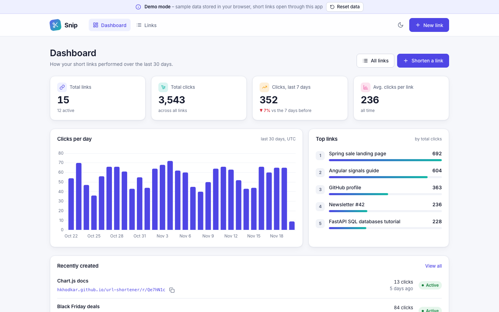
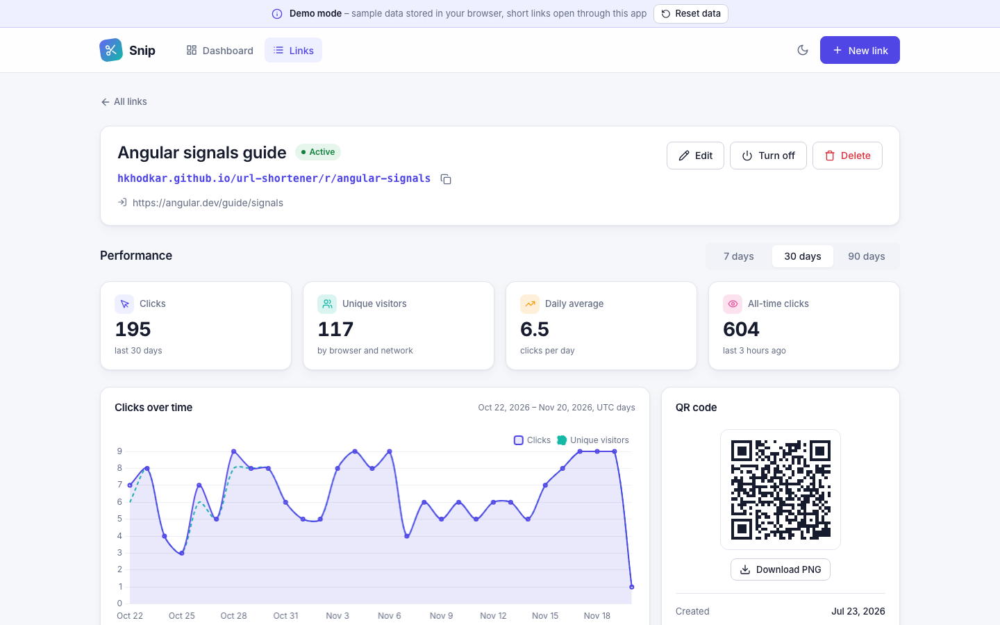
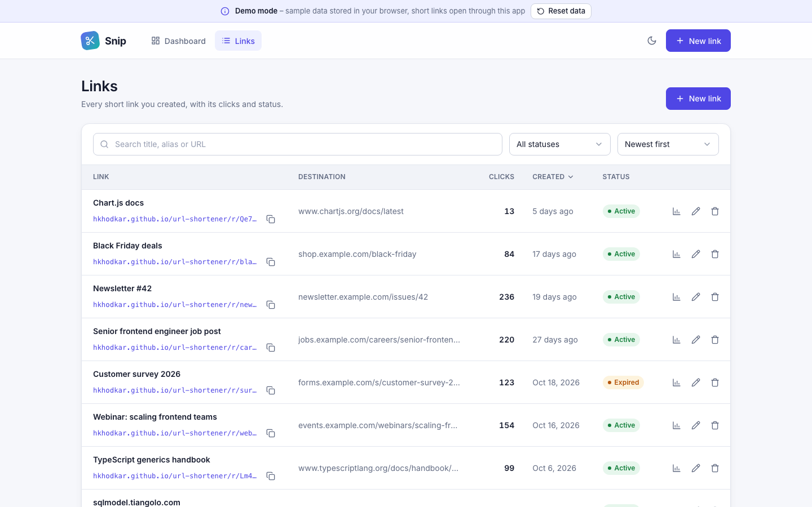
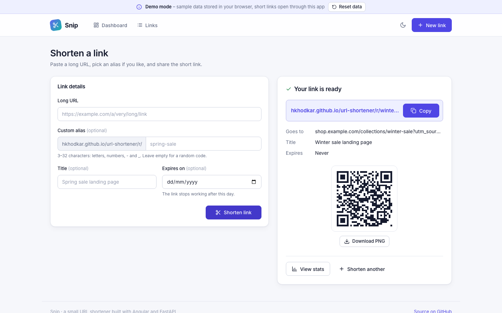
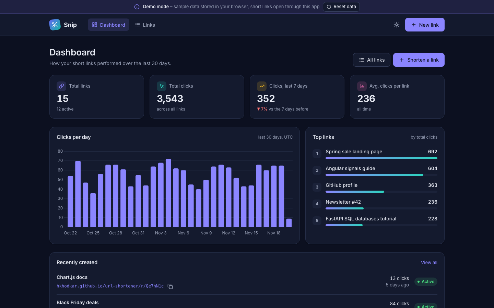
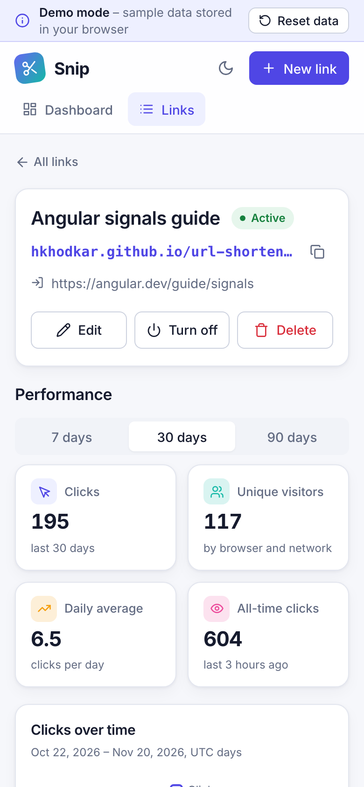
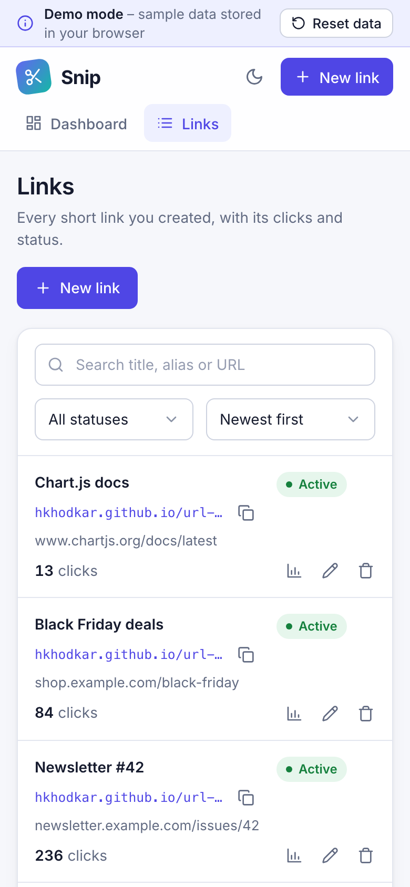

# Snip – URL Shortener

A small, full-stack URL shortener: custom aliases, expiry dates, QR codes and click statistics, built with Angular 21 and FastAPI.

**Live demo:** https://hkhodkar.github.io/url-shortener/



## Features

- **Shorten form** – long URL validated as http/https, optional custom alias with a live (debounced) availability check against the API, optional title and expiry date.
- **Result card** – short link with a copy button ("Copied" feedback) and a QR code drawn in the browser, downloadable as PNG.
- **Links list** – search, status filter (active / expired / disabled), sorting by date, clicks, title or expiry, pagination. Truncated destinations show the full URL in a tooltip. The list state lives in the URL, so filters survive a reload. On phones the table turns into cards.
- **Edit and delete** – change title, destination, expiry or turn a link off in a modal; delete with a confirmation.
- **Link stats** – total clicks, unique visitors, daily average, clicks over time, and breakdowns by referrer, country, device, browser and OS for the last 7, 30 or 90 days.
- **Dashboard** – total links and clicks, week-over-week change, clicks per day, top links and recently created links.
- **Redirects** – `GET /{code}` answers with a 302 and records the click (user agent parsed into device / browser / OS, referrer reduced to its domain, country from a CDN header or the browser language). Unknown codes get a 404, expired or disabled links a 410.
- **Demo data** – 15 links with about 3,500 generated clicks over the last 90 days are seeded on startup.
- Light and dark theme, responsive down to 360px.

| Link stats | Links |
| --- | --- |
|  |  |

| Shorten a link | Dark theme |
| --- | --- |
|  |  |

<p>
  
  
</p>

## Tech Stack

**Frontend:** Angular 21 (standalone components, signals, zoneless, OnPush, new control flow, typed reactive forms with sync and async validators, lazy routes), Chart.js through a small directive, `qrcode` for the QR codes, hand-written SCSS with CSS variables for theming, Vitest.

**Backend:** FastAPI, SQLModel / SQLAlchemy 2 on SQLite, Pydantic v2, pytest, Ruff.

**Tooling:** Docker and docker compose, GitHub Actions for CI and the GitHub Pages deploy.

## How the live demo works

GitHub Pages can only host static files, so the demo build (`ng build --configuration demo`) ships a mock backend: a functional HTTP interceptor that answers every `/api` call from an in-browser database. It follows the FastAPI routes closely – same response shapes, filters, sorting, paging, validation errors and status codes – and computes the stats from raw click events in the browser. The demo data is generated with the same seeded random generator as the backend seed, so both start with identical links and clicks. Changes are saved in `localStorage` and the banner at the top has a **Reset data** button.

Short links in the demo point to a route inside the app, `https://hkhodkar.github.io/url-shortener/r/<code>`. Opening one records a click (device, browser and OS from your user agent, country from your browser language) and then sends the browser on to the target URL, just like the backend's `GET /{code}` does. With the real backend, short links are served by FastAPI directly.

In a normal build the mock stays off. It only switches on by itself when no API answers (for example when you run `ng serve` without the backend).

## Getting Started

### Docker

```bash
docker compose up --build
```

- App: http://localhost:8080
- API docs (Swagger UI): http://localhost:8000/docs
- Short links: `http://localhost:8000/<code>`

### Local development

Backend (Python 3.12):

```bash
cd backend
python -m venv .venv && source .venv/bin/activate
pip install -r requirements-dev.txt
uvicorn app.main:app --reload --port 8104
pytest
```

Frontend (Node 22+):

```bash
cd frontend
npm ci
npm start          # http://localhost:4304, /api is proxied to port 8104
npm test -- --watch=false
npx ng build --configuration demo   # the static demo build
```

### Configuration

| Variable | Default | Purpose |
| --- | --- | --- |
| `DATABASE_URL` | `sqlite:///./links.db` | SQLAlchemy database URL |
| `SHORT_BASE_URL` | `http://localhost:8104` | Short links are built as `<SHORT_BASE_URL>/<code>` |
| `SEED_DEMO_DATA` | `true` | Load the demo links when the database is empty |
| `CORS_ORIGINS` | `http://localhost:4304` | Comma separated list of allowed origins |

## API

Interactive docs are available at `/docs` when the backend runs.

| Method | Path | Description |
| --- | --- | --- |
| `GET` | `/api/links` | List links: `search`, `status`, `sort`, `page`, `page_size` |
| `POST` | `/api/links` | Create a link (`target_url`, optional `alias`, `title`, `expires_at`) |
| `GET` | `/api/links/check-alias?alias=` | Is an alias valid and still free? |
| `GET` | `/api/links/{code}` | One link with its click count |
| `PATCH` | `/api/links/{code}` | Change title, target, expiry or `is_active` |
| `DELETE` | `/api/links/{code}` | Delete a link and its clicks |
| `GET` | `/api/links/{code}/stats?range=7\|30\|90` | Timeline and breakdowns |
| `GET` | `/api/summary` | Dashboard numbers |
| `GET` | `/api/meta` | Short link base URL and alias rules |
| `GET` | `/{code}` | 302 redirect that records the click, 404 / 410 otherwise |

Random codes are 7 base62 characters. Aliases are 3–32 letters, digits, `-` or `_`, start and end with a letter or digit, are unique regardless of case and can't be one of the reserved words (`api`, `docs`, `links`, …).

## Project Structure

```
url-shortener/
├── backend/
│   ├── app/
│   │   ├── main.py          # app factory, routers, startup seeding
│   │   ├── models.py        # Link and Click tables (SQLModel)
│   │   ├── schemas.py       # request and response models
│   │   ├── services.py      # list queries, stats and summary
│   │   ├── codes.py         # base62 codes, alias rules, reserved words
│   │   ├── tracking.py      # user agent, referrer and country parsing
│   │   ├── seed.py          # demo links and generated clicks
│   │   └── routers/         # links, summary/meta, redirect
│   ├── tests/
│   └── Dockerfile
├── frontend/
│   └── src/app/
│       ├── core/            # models, API client, validators, stats aggregation, mock backend
│       ├── shared/          # modal, toasts, QR code, copy button, chart and tooltip directives
│       ├── layout/          # header and page shell
│       └── features/        # dashboard, shorten, links, link-detail, redirect
├── docs/                    # screenshots
├── docker-compose.yml
└── .github/workflows/       # CI and GitHub Pages deploy
```

## Author

**Hatef Khodkar** – [github.com/hkhodkar](https://github.com/hkhodkar)

## License

[MIT](LICENSE)
